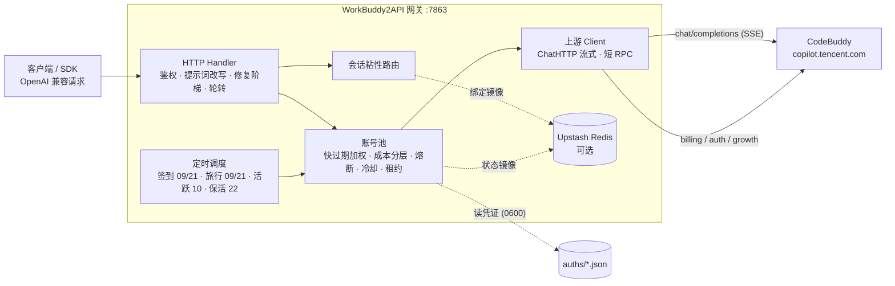

<p align="center">
  
</p>

<h1 align="center">WorkBuddy2API Panel</h1>

<p align="center">
  <b>把腾讯 CodeBuddy 账号变成 OpenAI 兼容 API 的多账号网关 · 附 Web 管理面板</b><br>
  OAuth 登录 · 账号池轮转 · 熔断冷却 · 会话粘性 · 定时签到 / 活跃 / 保活 · 成长任务一键完成（17/18）
</p>

<p align="center">
  
  
  
  
</p>

---

> **本仓库是 [Sliverkiss/workbuddy2api](https://github.com/Sliverkiss/workbuddy2api) fork 的增强分支**：上游已删库，本分支已同步至其最后一次更新（`ea8b1e5`），此后独立演进，新增可视化运维层与任务体系；上游设计（账号池调度、错误分类、提示词体系）原样保留。
>
> ⚠️ 仅限**自用账号**（签到 / 保活 / 个人工具接入）。禁止批量小号分发额度、二次打包或收费售卖，详见[使用声明](#使用声明必读)。

## 使用声明（必读）

本项目免费开源、按「原样」提供，初衷只有一个：**方便个人管理自己的 CodeBuddy 账号**。对下列行为明确反对：

1. **批量注册 / 收购小号，对外提供付费 API、共享池、代充**——违反 CodeBuddy 服务条款，后果（封号、条款违约、法律风险）自负，与作者无关；
2. **二次加壳、捆绑卡密售卖，或以「公益服」「低价中转」名义变相收费**——本项目永远免费开源，任何收费版本都是他人篡改产物；`auths/` 存的是**明文 token**，此类分发可能被植入后门回传凭证；
3. MIT 协议赋予**代码层面**的自由，**不赋予**以本项目名义宣传、售卖、捆绑分发，或要求作者支持与背书的权利；
4. 若滥用持续，作者可随时停止维护或删除仓库，不另行通知。

用于管理自己的账号时，欢迎正常使用、反馈问题与提交 PR。

## 项目简介

自托管的 **OpenAI 兼容反向代理网关**，把腾讯 CodeBuddy（`copilot.tencent.com`）账号包装为统一的 `/v1/chat/completions`。官方不提供 OpenAI 形态开放 API，本项目通过 **OAuth 设备授权**取凭证，在网关侧完成 token 刷新、账号池调度与流量治理；对客户端只暴露 OpenAI 接口，现有 SDK / 前端 / 工具**零改造接入**。

> ⚠️ 非官方网关，仅限本人授权账号、本机 / 私有环境使用，边界见[安全与合规](#安全与合规)。

## 核心能力

| 能力 | 说明 |
|---|---|
| 🔑 **OAuth 一键登录** | 面板内完成设备授权，凭证落盘并热加载进池，免重启 |
| 🔄 **多账号池** | 积分到期偏好（三档加权 + 濒临作废硬层）+ 成本分层 + 加权随机选号，Top-5 候选 + 防惊群 |
| 🛡️ **熔断与冷却** | 429 软冷却 600s 起指数退避、402 硬冷却至次日 04:00、404 固定 60s、连续失败熔断、在途租约限流 |
| 🧲 **会话粘性** | 同一 `conversation_id` 绑定同一账号，TTL 滚动续期，失败自动解绑，可镜像 Redis 防重启丢失 |
| ⏰ **定时任务** | 签到（含连登兑换 + 抽奖）、活跃上报、猫猫旅行、token 保活、夜猫子五类独立排程 |
| ⚡ **流式 + 非流式** | 出站强制 `stream:true`；SSE 帧按规范白名单重建；非流式由本地聚合 |
| 🧠 **推理模型兼容** | 思维链注入 + `reasoning_content` 多轮回填 + effort 档位自动降级 |
| 💬 **提示词体系** | `custom` / `append` / `passthrough` 三模式；撞 11-128 拦截时走**保真修复阶梯**，见[下文](#内容拦截误报与修复阶梯11-128) |
| 🗑️ **指纹脱敏** | 出站请求体黑名单指纹清洗（含 tools 描述、`@ 路径说明段`），可关闭 |
| 📊 **可观测** | 每请求一行表格日志（TTFB / token 速率 / uid）；`/healthz` 带身份标识可接探活 |
| 💾 **状态持久化** | 池状态本地原子落盘 + Upstash Redis 异步镜像（可选） |
| 🖥️ **Web 面板** | 内嵌单页（明暗主题，七个视图）：账号池 / 用量 / 积分构成 / 任务中心 / 模型与档位 / 配置 / 运行日志 |

## 🎯 成长任务一键完成（17/18）

官方「成长计划」18 个任务中 **17 个可在面板一键纯 API 完成**（无需官方客户端、无需人工交互），点一下即自动推进进度、等异步计分落定并**自动领奖**；剩余 1 个（`Expert_Philanthropy`）需真实捐款，服务端校验捐赠回执，展示操作指引。

- 覆盖对话 / 领养 / 画布 / 桌面行为链 / 模板 / 灵感案例 / 专家召唤 / 技能 / 主题 / 资料库等，全新账号一键做完约 **+1950 credits +78 能量**，其中仅少数任务发真实短对话，其余为行为事件上报；
- **限时「体验某专家」系列零登记**：面板从任务自带 `jump_url` 抽 `expertId=ex_...`（百分号编码 deeplink 两种形态都认），复用专家召唤+使用链，上游以后新下发同类任务自动可跑；
- 行为事件按天幂等：重复点不会重复扣资源，已达标自动跳过；执行前**自动 accept**（`not_accepted` 状态下上游不下发 `target`，事件一律不归账），两轮不动就停下等下次调度，不反复烧配额；
- 「任务中心」视图提供全账号扫描 → 按账号排队执行（账号内串行、账号间可选并发 1-3）、开学季状态矩阵，日志按「任务 / 对话 / 系统」分频道。

计分走 `/v2/report` 行为上报，但不同任务认不同客户端指纹（CLI / 桌面 / web / 小程序），网关为每类构造对应判据事件链；上报 200 ≠ 计分，面板轮询进度达标后调 Web 域领奖接口。

## 架构总览



出站前统一过改写管线（`internal/upstream/payload.go`）：强制 `stream:true`、`developer` 角色归一、`tool_choice` 归一、`image_url` 字符串兼容、思维链注入、effort 档位降级、`reasoning_content` 回填、指纹脱敏。

## 快速开始

**环境要求**：Docker + Compose（服务端部署）或直接跑单文件二进制；一个以上已注册 CodeBuddy 账号；从源码构建需 Go ≥ 1.22.5。

### 方式一：Docker Compose（推荐）

```bash
git clone https://github.com/linguo2625469/workbuddy2api-panel.git
cd workbuddy2api-panel
cp config.example.json config.json     # compose 挂载此文件，缺失会导致启动失败
docker compose up -d --build           # 首次构建约 1-2 分钟
curl -s http://localhost:7863/healthz  # 无可用账号时 503
```

常用运维：`docker compose logs -f` / `restart` / `down`（数据在 `./auths`、`./data`，不受影响）。

### 方式二：GHCR 镜像（免克隆免构建）

CI 构建 `amd64` / `arm64` 镜像发布到 GHCR；首次使用需把 package 设为 public，否则要先 `docker login ghcr.io`：

```bash
mkdir -p auths data && cp config.example.json config.json
docker run -d --name workbuddy2api \
  -p 7863:7863 -e TZ=Asia/Shanghai \
  -v ./auths:/app/auths -v ./data:/app/data -v ./config.json:/app/config.json \
  ghcr.io/linguo2625469/workbuddy2api-panel:latest
```

镜像 tag：`main` 分支推 `latest` / `main` / `sha-xxxxxx`；`v*` tag 额外发布语义化版本；PR 只构建不推送。

### 方式三：Windows 单文件（无需 Docker）

```powershell
# 下载 Release 里的 wb2api.exe，或自行构建
go build -trimpath -ldflags="-s -w" -o wb2api.exe ./cmd/server
.\wb2api.exe -config config.json
# 浏览器打开 http://127.0.0.1:7863/panel/
```

前端资源已 embed 进二进制，**单文件自包含**；首次启动自动生成 `config.json`（含 `crypto/rand` 随机 `api_key`，日志打印一次），只需保证 `auths/`、`data/` 可写。

### 方式四：源码运行（开发调试）

```bash
go build ./... && go vet ./... && go test ./...
go run ./cmd/server -config config.json
```

### 添加账号

- **面板（推荐，各平台通用）**：打开 `http://127.0.0.1:7863/panel/` → 右上角「添加账号」→ 展示授权链接 → 浏览器登录 → 自动落盘并**热加载进池**，顺带完成首次签到；也支持导入 cockpit tools 导出的 JSON。
- **命令行（Linux / macOS，需 bash + python3）**：`./login.sh`，按提示完成后凭证落盘 `auths/workbuddy-<uid>.json`。Windows 用面板或 WSL。

### 验证

```bash
curl -s http://localhost:7863/v1/models -H "Authorization: Bearer your-api-key"
curl -s http://localhost:7863/status  -H "Authorization: Bearer your-api-key"

curl -sN http://localhost:7863/v1/chat/completions \
  -H "Authorization: Bearer your-api-key" -H "Content-Type: application/json" \
  -d '{"model":"deepseek-v4-flash","messages":[{"role":"user","content":"hi"}],"stream":true}'
```

## 配置说明

`config.example.json` 是**最完整的参考**（每个字段、默认值与结构都在里面，示例值一律是 `test_key` 之类占位符，不含真实密钥）。下表只列最常改动的字段。

### 常用字段

| 字段 | 默认 | 说明 |
|---|---|---|
| `listen` | `:7863` | HTTP 监听地址 |
| `api_key` | 空 | 网关鉴权密钥；**空 = 不鉴权直接放行**（公网必须设置） |
| `auth_dir` / `state_file` | `./auths` / `./data/state.json` | 凭证目录 / 池状态文件 |
| `prompt.mode` | `custom` | 系统提示词模式：`custom` 用网关提示词替换客户端 system；`append` 在其后插入（既有消息不动）；`passthrough` 原样透传 |
| `prompt.file` | 空 | 自定义提示词路径；空 = 内置默认（约 2KB，嵌入二进制），路径不可读则启动报错 |
| `repair.enabled` | `true` | 11-128 修复阶梯总开关；`false` = 退回旧的「一次 400 → 全局降级 → 重试一次」 |
| `repair.degrade_ttl` | `30m` | L4 局部降级 TTL（钳 `[5m, 24h]`）；`"day"` = 到次日 00:00 CST 的旧语义 |
| `repair.budget` | `3` | 每请求允许为修复额外消耗的上游调用次数（不挤占 `max_rotate` 换号预算） |
| `repair.dump_dir` | `dump` | 全阶梯失败时的现场落盘目录（相对 state 目录，只含 system 文本）；空 = 关闭 |
| `cooldown.soft_rate` / `cooldown.soft_rate_max` | `600s` / `2h` | 软限流冷却基数 / 指数退避封顶 |
| `features.sanitize_blacklist_fingerprints` | `true` | 出站请求体黑名单指纹脱敏 |
| `schedule.*_enabled` / `schedule.*_hours` | 见[定时任务](#定时任务) | 五类任务的开关与整点时点；`*_hours` 空数组 = 回落默认（不是禁用） |
| `upstream.user_agent` | 空 | 出站 UA 覆盖（空 = `CLI/2.63.2 CodeBuddy/2.63.2`）。官网「使用端」列按此归因 |
| `pool.max_in_flight` / `pool.max_in_flight_global` | `3` / `2` | 单账号在途上限（global 域风控更紧，压低并发） |
| `pool.prefer_expiring` / `pool.expiring_soon` | `true` / `168h` | 积分到期偏好总开关 / 到期统计窗口 |
| `pool.credit_floor` | `0`（关） | **积分保底**：余额低于该值时不再参与实测收费模型（tier 2）的选号，防止把余额打穿导致连免费模型都被 402 到次日；免费 / 无观测层不受限 |
| `session_sticky.enabled` / `.ttl` / `.gc_interval` | `true` / `30m` / `5m` | 会话粘性开关 / 绑定 TTL（滚动续期）/ GC 周期 |
| `logging.request_archive_enabled` / `request_retention_days` / `request_client_info` | `true` / `7` / `true` | 请求元数据 JSONL 归档 / 保留天数 / 是否记录来源 IP·UA |
| `server.read_timeout` | `300s` | 入站读取（含 body 上传）总时长；大上下文经反代转发易超时，`0` = 不限，改动需重启 |
| `upstash.url` / `upstash.token` | 空 | 空 = 纯内存（Noop 降级，功能照常） |

### 上游超时（三段各归其位）

| 字段 | 作用对象 | 默认 | 行为 |
|---|---|---|---|
| `upstream.timeout_seconds` | 短 RPC（刷新 / 签到 / 余额 / 模型列表） | `120` | 总时长硬上限，超时走换号 / 熔断 |
| `upstream.header_timeout_seconds` | 聊天 SSE **首字节前** | 回落上一项 | 超时 = 换号重发 |
| `upstream.idle_timeout_seconds` | 聊天 SSE **流中空闲** | `300` | 活跃吐数据续命，静默超时才断流释放租约 |

聊天流没有总时长上限（专用 `Timeout=0` client），长思考 / 长输出不会被掐断。

### 环境变量覆盖

加载顺序：JSON → `WB2A_*` 环境变量（非空才覆盖）：`WB2A_LISTEN` · `WB2A_API_KEY` · `WB2A_AUTH_DIR` · `WB2A_STATE_FILE` · `WB2A_SOFT_RATE` · `WB2A_SOFT_RATE_MAX` · `WB2A_TIMEOUT_SECONDS` · `WB2A_HEADER_TIMEOUT_SECONDS` · `WB2A_IDLE_TIMEOUT_SECONDS` · `WB2A_USER_AGENT` · `WB2A_SANITIZE_FINGERPRINTS` · `WB2A_PROMPT_MODE` · `WB2A_PROMPT_FILE`

## 核心行为语义

### 系统提示词体系

客户端（Claude Code / Codex 等 CLI）会在 system 注入固定模板句，上游内容审核按**逐字精确匹配**误杀合法流量（HTTP 400 + 审核文案）。两层防护互不替代：

1. **提示词体系**（治 system / developer 来源的误报）——由 `prompt.mode` 控制：`custom` 删除客户端 system / developer 并在头部插入单条网关 system（user / assistant / tool 逐字不动）；`append` 在开头连续 system 块后**插入**网关 system，客户端项目规范原样保留（降级期退化为 replace）；`passthrough` 不改写。
2. **指纹脱敏**（兜底 user / assistant 消息里的指纹串）——由 `features.sanitize_blacklist_fingerprints` 控制。

### 内容拦截误报与修复阶梯（11-128）

`passthrough` / `append`（要保真客户端 system）下撞拦截（HTTP 400 + `blocked by security policy` / `unapproved channel` / `illegal api invocation`）时，**同一请求内**按「语义损失从小到大」逐级抢救，前一级成功即停止。

| 级别 | 动作 | 代价 | 说明 |
|---|---|---|---|
| L0 | `EnsureSystemFirst` | 不丢 | 首条必须是 `system`（`developer` 就地归一）。首条是 `user` / `developer` 会被上游回 11-128 同一句文案，极易误判成内容拦截 |
| L1 | 指纹脱敏 | 同义改写 | 始终生效、不算重试级：`@ 路径说明段` 整段改写、`You are … powered by …` 句式、`tools[].function.description`、上游注入身份回流 |
| L2 | `SplitSystemMessages` | **一字不改** | 把最长那条 system 按句界拆成多条 system——上游按「连续原文」匹配，句界一断即失配，通道仍是 system |
| L3 | `MoveSystemToUser` | **一字不改** | system 原文搬进首条 user、system 换中性句；拆不动时用（如只剩一句） |
| L4 | 中性提示词 | 丢客户端 prompt | 只影响同一 `(realm, 段指纹)` 桶，默认 30 分钟后自动恢复 |

- **降级作用域**：`(realm, system 文本指纹)` 为桶，不再是进程级单例——一个客户端的指纹不会污染全站；面板显示「N 段 / 全域兜底 / 至几时」，可一键恢复（`POST /panel/api/degrade/clear`），不必重启；
- **realm 兜底**：15 分钟内 ≥3 个不同段都走完全阶梯仍失败 → 该 realm 整体降级 30 分钟，避免被按 realm 封语义时每个请求白跑 4 次上游调用；
- **段指纹记忆**（`data/repair-memory.json`）：某段降到某级救回来即入库，第二次命中从该级起步；可面板灌库（`POST /panel/api/repair/memory`）或删条目；
- **现场落盘**（`repair.dump_dir`）：全阶梯失败时写一份只含 system 文本与角色序列的诊断 JSON（不含对话内容），喂 `go run internal/probe/probe_repair.go -dump …` 离线二分出「最少几句连排才被拦」；
- 内容问题不是账号问题：`ErrContentBlocked` 不罚号（无冷却 / 熔断 / 计错）；`repair.enabled=false` 可整体退回旧行为。

> 设计依据（真机实测）：上游对这类指纹按**连续原文**匹配而非语义审核——整段放 system → 400；按句界拆开 → 200；同义改写 → 200；原文搬进 user → 200。同一 body 换账号结果一致，所以轮转无用、也不该罚号。

### 原生工具调用标记还原

上游（DeepSeek 系）的工具调用原生语法是带**全角竖线**分隔符的标记文本（`<PIPE>DSML<PIPE> calls>` …），且**只在请求声明了 `tools` 时**才被解析成结构化 `tool_calls`。而 `tools` 在中转链路（Responses → chat/completions 等）丢失是常态：模型仍想调工具，标记就以纯文本落进 `content`，Codex 这类只执行结构化 `function_call` 的客户端把它当正文写进历史，回合直接结束、工具一次没跑。

网关在出站响应里做最后一道还原（`internal/upstream/dsml.go`），流式与非流式都覆盖：工具名单非空时按名单**严格**校验；名单为空（`tools` 丢失，实测常态）时退化为**弱**校验（块完美闭合 + 工具名形如合法标识符）。名单同时取自本请求 `tools` 与会话历史里的 `tool_calls`。三条硬前提——本回合无结构化 `tool_calls`、块内不夹带正文、非流式要求 `finish_reason=stop`——任一不满足即**原文逐字节透出**，修复层绝不吞字节。命中与否各记一行日志，便于区分「没识别到」与「识别到但判定不通过」。

### 错误分类与账号处置

上游错误由 `Classify` 统一分类（优先级：余额耗尽 → session 失效 → 限流文案 → 状态码兜底）：

| 分类 | 触发条件 | 账号处置 | 恢复 |
|---|---|---|---|
| 余额不足 | HTTP 402 / body 含余额关键词 | 硬冷却到**次日 04:00** | 签到余额恢复自动解冻 |
| 频控 | HTTP 429 / 限流文案 | 软冷却 `soft_rate` 起，连续触发指数退避，封顶 `soft_rate_max`；`code 6004` 带重置时间时冷却到该墙钟并豁免切模型 | 到期恢复 / 成功清零 |
| Session 失效 | `Offline user session not found` / `12153` | **连续 3 次**才永久禁用（一次 12153 多为抖动） | 重新登录或 `ReviveDisabled` |
| 上游 404 | HTTP 404 | 软冷却固定 60s | 到期恢复 |
| 服务端错误 | HTTP ≥500 | 计入连续失败，达阈值熔断 | 熔断到期 / 成功清零 |
| 请求体解析失败 | 400 + `Unmarshal chat params failed` / `11101` | **不罚号但仍轮转**（客户端畸形 JSON） | 即时 |
| 内容拦截 | 400 + 审核文案 | **不罚号**，走修复阶梯 | 即时 |
| 客户端错误 | 其余 4xx / 业务 `code≠0` | 不处罚，换号重试 | 即时 |

**熔断**：所有冷却入口与 5xx 共用连续失败计数 `fails`，达 `breaker_threshold`（默认 3）熔断，退避 `breaker_cooldown × 2^retryCount` 封顶 `6h`。**软冷却退避**是并存的第二条线：`soft_rate × 2^(连续次数-1)` 封顶 `soft_rate_max`，计数 `soft_streak` 独立持久化，仅成功或签到解冻时清零。

**下游 429 带 `Retry-After`**：全池冷却时返回的 `429 rate_limit_exceeded` 附 `Retry-After: <秒>`，取「最早再有账号能接该模型」与上游明示值中较晚者；算不出来则**不带**该头（不编造）。

### 选号与会话粘性

选号：

1. 过滤禁用 / 冷却 / 熔断 / 在途占满的账号；
2. 按模型实测成本分层，只保留当前最优层；
3. 到期偏好（默认开，仅对「该号上确实扣积分」的模型生效）：24h 内到期 ×6、72h 内到期 ×4、窗口内 ×3，再乘金额占比因子 `min(1, 窗口内到期 / 余额 × 2)`，并设相对上界（不超过同层基准权重中位数 ×4）；`24h 内到期 ≥200 分` **且** `≥ 余额 20%` 时进入**濒临作废独占层**（双条件不可省，否则「每天滴水」的号会天天占位）；
4. 加权随机：`weight = (积分比例 ×10 + idleWeight) × 到期乘子`，`idleWeight = min(闲置小时 × 0.5, 5)`；
5. 防惊群：跳过 100ms 内刚选中的账号；top5 全被跳过时在最旧 5 个里**按权重抽签**（直接取最旧会让权重与到期偏好失效）；全冷却时从非禁用、非余额耗尽的软冷却 / 熔断账号里选最早到期者顶班。

会话粘性：会话键依次取 `metadata.conversation_id` → `conversationId` → `user_id` → 顶层同名键；TTL 滚动续期（默认 30m）、GC 5m、可镜像 Redis（7 天）防重启丢失；失败自动解绑，成功则绑定跟随最终账号；已绑定会话**不因到期偏好迁移**（迁 = prompt cache 全 miss）。

### 定时任务

五类任务各自独立排程与开关，容器时区由 `TZ` 控制（compose 默认 `Asia/Shanghai`）。

| 任务 | 开关 / 时刻（默认） | 行为 |
|---|---|---|
| 签到 | `checkin_enabled` / `[9, 21]` | 签到 + 余额查询，余额恢复则解冻冷却账号；**末尾追加连登管家**（已解锁档位自动兑换 → 抽奖次数自动抽完） |
| 活跃上报 | `activity_enabled` / `[10]` | `chat_request_send` 事件（必须含 `userId`），点亮连登 + 解锁 `first_buddy`；每号每天 1 次 |
| 猫猫旅行 | `travel_enabled` / `[9, 21]` | 每趟只做一个动作：无猫领养 / `idle` 派出 / `arrived` 领奖，不轮询 |
| 保活 | `keepalive_enabled` / `[22]` | 全账号刷新 token；session 失效连续 3 次才禁用 |
| 夜猫子 | `blackcat_enabled` / `[23]` | 先查进度再决定：`black_cat` 未达标才在 23:00–08:00 窗口补 glm-5.2 短对话 |

- **关闭**用 `*_enabled: false`；空数组 / `null` 是「未配置 → 回落默认」不是禁用；禁用不擦除 `*_hours`；关签到会连带关掉「余额恢复即解冻」。
- **同槽错峰**：多类任务撞同一小时按固定偏移起跑（签到 0s、旅行 45s、活跃 90s、保活 135s、夜猫子 180s、成长 225s），避免同一账号几秒内被连打触发 429；签到后 1s 再查余额。
- **429 补跑**：签到 / 余额查询吃 429 时按 `Retry-After`（无则 60s、120s）延迟补跑，最多 2 次；只对幂等调用生效，旅行不入队（派出消耗当日次数、领奖一次性）。队列只在内存，重启即丢。
- **余额后台刷新**（`schedule.balance_refresh_enabled`，缺省开）：每 5 分钟刷全部账号余额（并发 2、间隔 300ms），两次签到之间 credits 保持新鲜；面板「立即刷新」同口径，5 秒自动轮询只读内存不打上游。

账号级语义（无需配置）：

| 状态 | 语义 |
|---|---|
| **禁用** | 退出选号，且四类保号任务（签到 / 活跃 / 保活 / 余额刷新）默认跳过。若用作「一次只放开一个号」的流量开关，设 `schedule.include_disabled_in_tasks: true` 让禁用号照常保号（仍不参与选号） |
| **暂停选号** | 退出选号但保号四任务与任务体系照常（仅夜猫子跳过，它整任务都是真实对话）；运维临时态，随时恢复，状态持久化跨重启不丢 |
| **企业版** | 无个人成长体系，网关对该账号**不发起**签到 / 活跃 / 旅行 / 夜猫子 / 连登调用；额度走 `get-enterprise-user-usage`（上游 `credit` 是已用、`limitNum` 是分配额度，故剩余 = `limitNum − credit`，`-1` 为不限量），`cycleResetTime` 未用完即作废故参与到期偏好 |

> 账号行「暂停选号」比全局开关更常用：让位的号不承接选号流量、也避开夜间对话补足，其余养号动作照常。区别是「禁用」为终态（需人工解冻，保号默认也停），「暂停」为运维临时态。

## API 端点

| 端点 | 鉴权 | 说明 |
|---|---|---|
| `POST /v1/chat/completions` | Bearer | OpenAI 兼容补全，流式 / 非流式；请求体不设网关侧上限，超限由上游如实返回 |
| `GET /v1/models` | Bearer | 模型列表（动态拉取，缓存 1h，失败 5min 负缓存）；每模型带 `context_length` / `max_output_tokens` / 思考档位 / 倍率等上游字段 |
| `GET /status` | Bearer | 账号汇总 + 每账号详情（积分 / 冷却 / 熔断 / 在途 / 粘性）+ `model_locks`（按「域 + 模型」的限流视图）+ `degrade_scopes` + `repair_active` |
| `GET /healthz` | 无 | 有可用账号返回 200，否则 503；响应带 `service` 字段与 `X-Service` 头 |

仅当 `api_key` 非空才校验 `Authorization: Bearer <api_key>`；`/healthz` 恒无鉴权。

```json
{"healthy": 2, "total": 3, "service": "workbuddy2api"}
```

`service` 字段 / `X-Service` 头用于区分本网关与同端口残留的其他服务（对方即使 2xx 也不带该标识，避免探活「假成功」）。持有 key 的探活建议用 `/status` 强校验。

流式细节：出站强制 `stream:true`，SSE 帧按 OpenAI 规范白名单重建（`reasoning_content` 保留、工具调用按 index 合并、未知字段剥离）；保证恰好一个 `data: [DONE]`（上游漏发时补写），空流先写一帧 `error`；非流式由本地聚合为单个 `chat.completion`。

> 上游接口均为 CLI / 插件使用的非公开、逆向接口，路径以代码内常量为准；`copilot.tencent.com` 承载聊天 / 刷新 / OAuth / 模型列表 / growth 域，`www.codebuddy.cn` 承载签到 / 余额 / 活跃上报。出站统一 `CLI/2.63.2 CodeBuddy/2.63.2` UA（可被 `upstream.user_agent` 覆盖），聊天请求带账号头但**永不携带 `X-Refresh-Token`**。

## 🖥️ Web 管理面板

内嵌单页（`internal/panel`，前端 go:embed 单文件进二进制，无外部构建依赖），`http://127.0.0.1:7863/panel/`。鉴权与 API 同口径（`api_key` 非空时输入一次，localStorage 记住），支持明暗主题切换。

| 视图 | 功能 |
|---|---|
| **账号池** | 统计条 + 账号表（健康色条 / 积分量条 / 成功失败计数 / 在途 / 最近用量与延迟）；单号签到 · 余额 · 任务 · 解冻 · 禁用 · 移除，批量签到 / 旅行 / 活跃 / 保活；下方**模型锁池**表列出被按模型限流的模型与解锁倒计时 |
| **用量** | 指标卡（请求 / token / 失败 / 平均延迟）+ Token 时序图 + 按账号 / 模型 / 域切换的明细 + 积分扣除历史（折算「积分 / 1M Token」） |
| **积分构成** | 积分到期分布（按批次到期日聚合）+ 账号对比 + 逐包明细（其余未用完包折叠） |
| **任务中心** | 全账号待办扫描 → 排队执行（账号内串行，账号间并发 1-3），进度实时更新，见[任务体系](#-成长任务一键完成1718) |
| **模型与档位** | 实时查询上游倍率（含限时免费 / 夜间折扣的生效价与划线牌价）、默认思考档、支持档位、上下文与最大输出；支持关键词 / 域 / 能力 / 档位 / 价格条件查询 |
| **配置** | 在线编辑 `config.json`：密钥、冷却、池参数、任务排程、上游与提示词、日志开关 |
| **运行日志** | 请求记录表（时间 / 结果 / 模型 / 账号 / 来源 IP / UA / 耗时 / token / 积分 / 请求 ID，可按维度与时间范围筛选）+ 按「任务 / 对话 / 系统」分频道的运行日志 |

顶部另有「刷新」（向上游全量查余额并回写）与「添加账号」（浏览器内完成 OAuth）。

- **时间范围查询**：「今天 / 自定义」由浏览器按本地时区算好再发给服务端（服务端时区可能不同），滚动预设走服务端 `hours` 口径，响应回显实际生效区间（`window_from` / `window_to`）；请求记录的时间过滤在归档侧完成，早于已拉取区间也能取到。
- **调用来源**：IP 取 `X-Forwarded-For` 首段 → `X-Real-IP` → TCP 对端；UA 截断 200 字节入库。IP 属个人信息，由 `logging.request_client_info` 控制（缺省开、热生效），关闭后归档与面板都不再出现来源字段。

### 面板接口（`/panel/api/*`）

与页面同一 Bearer 鉴权，可直接脚本化调用：

| 分组 | 端点 |
|---|---|
| 只读 | `GET overview` · `usage`（`hours` 或 `from`/`to`）· `packages` · `models` · `model_probes` · `logs` · `request_metrics` · `request_logs` · `config` · `tasks/queue` · `school/vouchers` · `degrade/scopes` · `repair/memory` |
| 账号运维 | `POST accounts/{uid}/checkin` · `balance` · `revive` · `disable` · `remove`；`POST checkin_all` · `travel_all` · `activity_all` · `keepalive_all` · `balance_all` |
| 任务 | `GET accounts/{uid}/tasks`；`POST accounts/{uid}/tasks/accept` · `accept_all` · `claim` · `auto` · `auto_all`；`POST tasks/scan_all` · `tasks/run_queue` |
| 添加账号 | `POST login/start` · `GET login/poll` · `GET login/regions` · `POST import/cockpit` |
| 修复 | `POST degrade/clear`（清降级范围）· `POST`/`DELETE repair/memory`（灌库 / 删条目） |
| 写入 | `POST config`（校验 → 落盘 → 热应用，返回需重启字段清单）· `POST usage/save` |

**配置热生效**：`api_key`、`cooldown.*`、`features.*`、`logging.request_client_info`、`pool.*`、`schedule.*` 保存后立即生效；装配期字段（`listen`、`auth_dir`、`state_file`、`server.read_timeout`、`upstream.*`、`upstash.*`、`session_sticky.*`、`repair.*`）会提示需重启。写入采用「深合并 + 原子替换」，用户手写的未知键原样保留。

面板与 `/panel/api/*` 统一带 CSP（`default-src 'none'`，脚本仅同源，`frame-ancestors 'none'`）、`nosniff`、`X-Frame-Options: DENY`、`Referrer-Policy: no-referrer`；Bearer 校验用 SHA-256 摘要 + 常量时间比较，上游 `uid` 经白名单校验后才用于拼凭证文件名（防路径穿越）。

> ⚠️ 服务自身只提供明文 HTTP，公网部署请置于 HTTPS 反代之后并配置访问限流。

## 请求级日志

每个 `/v1/chat/completions` 请求结束输出一行表格日志（stdout，无落盘文件）：

```text
| #001 | 18:31:31 | deepseek-v4 | stream | 200 | uid=0851ce35 | TTFB=801ms | tok=60 | 23.5tok/s | total=2.6s |
```

字段依次为：进程级序号、结束时刻、模型、模式（`stream` / `sync`）、状态码、uid 前 8 位、首帧耗时（非流式为 `-`）、输出 token 数 / 速率 / 总时长；撞修复逻辑时额外带 `repair=L2:ab12cd34`。**不含**任何 token 或 `api_key` 明文。

## 部署运维

### Docker 镜像

多阶段构建（`golang:1.23-alpine` → `alpine:3.20`），一次编译四个二进制（`wb2api` / `signin_bin` / `login` / `credit`）并带脚本；以 `app` 用户（uid 10001）运行，`auths/` 与 `data/` 预建，内置 `HEALTHCHECK`。账号与状态通过 `docker-compose.yml` 卷挂载持久化：`./auths`、`./data`、`./config.json`。

### 工具脚本

| 脚本 | 用途 |
|---|---|
| `./login.sh` | OAuth 登录 → 落盘 auth → 重启容器 |
| `./signin.sh [auths_dir]` | 批量签到（过期先刷新） |
| `./credit.sh` / `-json` | 积分日报（美化 / 原始 JSON） |
| `python3 scripts/probe_active.py` | 活跃上报诊断 / 补跑（写操作默认 dry-run，需 `--yes`） |
| `python3 scripts/probe_max_tokens.py` | 探测各模型真实输出上限，`--panel-out` 结果可直接进面板 |

二进制不在 git 中：脚本首次使用自动 `go build` 对应 `cmd/*`（镜像内已预编译）。

### 探测模型真实输出上限

上游 `/v3/config` 的 `max_output_tokens` 是**声称值**且普遍虚高——实测 16 个 CN 模型中 8 个被**静默钳制**（请求更大也不报错，到真实上限即截断），最狠的声称 1M 实际 32K。「模型与档位」视图因此支持叠加实测标注：🔴 `32K ⚠ 钳制 12×`、🟢 `48K ✓ / 64K ↑`、⚪ `≥40K`（满额未触顶）/ `?`（主动收尾未测出）。

实测值不写死在代码里，来自探测工具写入的数据文件（默认 `data/output_probes.json`），重跑即刷新、下次查询生效，未探测的模型不受影响：

```bash
python3 scripts/probe_max_tokens.py --base http://127.0.0.1:7863/v1 --key sk-xxx \
    --panel-out data/output_probes.json      # 会真实消耗积分；--resume / --models / --dry-run 可选
```

### 账号管理

- 新增账号：把 `auths/workbuddy-<uid>.json` 拷进目录即可，池启动时自动对齐；或用面板 / `login.sh`。
- Session 失效被禁用后（`/status` 透出 `disabled_reason`），重新登录覆盖凭证即可回池；已持久化 `disabled=true` 的可调 `Pool.ReviveDisabled(uid)` 复活。
- 备份 = `auths/`（凭证）+ `data/state.json`（积分 / 冷却 / 计数）；配 Upstash 后状态另镜像至 Redis（7 天 TTL）。

## 安全与合规

- **凭据**：`auths/workbuddy-<uid>.json` 内是明文 `accessToken` / `refreshToken`；刷新时以 `0600` 原子写回，建议手动 `chmod 600 auths/*.json`。`.gitignore` 已排除 `auths/`、`data/`、`config.json`、`*.key`、`*.pem`、`*.env` 及除 README 外的全部 `*.md`。
- **暴露面**：默认监听 `:7863`，**无内置 TLS**；公网必须设 `api_key` 并前置反代。
- **日志敏感度**：常规日志只含序号 / 模型 / 模式 / 状态码 / uid 前 8 位 / TTFB / token 数，不读取 `Authorization` 头；请求归档只存元数据，不写提示词与响应正文。来源 IP / UA 可关。
- **产物来源**：Release 由 CI（`.github/workflows/go-binaries.yml`）按 tag 构建多平台 zip，镜像由 `.github/workflows/docker-ghcr.yml` 发布到 GHCR——除这两条链路外的「收费版 / 卡密版」均非本仓库产物。
- **合规边界**：仅限本人授权账号、本机 / 私有环境；不得共享转售或用于违反目标平台条款的用途，详见[使用声明](#使用声明必读)。上游属腾讯系商业产品，本项目是其**非官方**网关，作者不对封号、条款违约或使用结果负责。

## 常见问题

### 429 `code=6004`（模型级限流）的冷却语义？

`6004` 是**该模型**用量超限，不是账号整体被限流（msg 通常带「将在 YYYY-MM-DD HH:MM:SS 重置」）。网关：冷却 `until` 精确取该墙钟（按 UTC+8 解释，封顶 `soft_rate_max`）；记录触发模型，改用**其他模型**时视为可用；无重置文案或普通软限流仍走 `soft_rate` 指数退避。

### 多图会话请求体超限怎么办？

网关**不设请求体上限**（`server.max_body_mb` 已移除，对齐上游）：任意大小都完整读入转发，超限由上游返回（信息量更大）。历史图片每轮 base64 重发、编码再膨胀约 37%，也不会撞网关侧 413；客户端中途断流导致的半截 body 在读入阶段即报 `400 invalid_request`，不会把截断 JSON 喂上游。

### Docker 部署登录后报「写入 auths/…json.tmp 失败：permission denied」？

容器以 `app`（uid 10001）运行，而挂载目录属主不是它。三种解法，前两种都不需要 root 容器：

```bash
# 1（推荐）让容器以你的 uid 运行——挂载目录本来就是你建的
PUID=$(id -u) PGID=$(id -g) docker compose up -d --force-recreate
#    或写进 .env 长期生效：echo "PUID=1000" > .env && echo "PGID=1000" >> .env

# 2 把挂载目录属主交给容器默认用户
sudo chown -R 10001:10001 ./auths ./data ./config.json

# 3 compose 设 user: "0:0" 以 root 运行（NAS / 群晖不便 chown 时用）
```

### 系统提示词被内容策略误杀怎么办？

默认 `prompt.mode=custom` 已从源头消除大部分误报；`passthrough` / `append` 下撞拦截走[修复阶梯](#内容拦截误报与修复阶梯11-128)：**先拆句（一字不改）→ 再搬家（一字不改）→ 最后才是局部降级**，降级只影响同一 `(realm, 段指纹)` 且 30 分钟自动恢复。排查顺序：

1. 面板顶部「提示词降级中（N 段）」→ 点「恢复」复位，看是否复发；
2. `/status` 的 `degrade_scopes` 看是哪一段（`seg` = system 文本 hash 前 8 位）；
3. 定位到具体句子：`go run internal/probe/probe_repair.go -dump data/dump/<file>.json -auths ./auths` 离线二分；
4. 测出级别后用 `POST /panel/api/repair/memory`（或手改 `data/repair-memory.json`）灌库 `{realm, seg, level}`，之后该段直接按该级出站。

### 账号被 Disable 后如何恢复？

用 `./login.sh` 或面板重新登录覆盖凭证后自动回池；或在源码侧调用 `Pool.ReviveDisabled(uid)` 清除 `disabled` 标志（`state.json` 同步刷新）。

## 免责声明

本项目仅供学习和研究使用。使用者需遵守 CodeBuddy 服务条款并自行承担风险（含账号封禁、条款违约等），作者不对任何因使用本项目产生的直接或间接损失负责。

## License

[MIT License](LICENSE)。允许任意使用、复制、修改、合并、发布、分发、再授权及销售；再分发时请保留原仓库的 MIT 版权与许可声明（可在 NOTICE 或 README 注明出处 `https://github.com/Sliverkiss/workbuddy2api`）。本项目不授予任何上游（CodeBuddy / 腾讯）接口或服务的权利，使用者仍需自行遵守上游服务条款。
